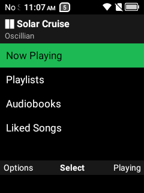
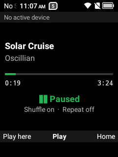

# FlipSpot

A **keypad Spotify front end** for Android flip phones, built for the TCL Flip 2. The official Spotify app
needs a touch screen; FlipSpot gives you playlists, Liked Songs, albums, audiobooks, search and full
playback control from the D-pad and number keys. Spotify still does the playing, offline downloads and
account; FlipSpot is the remote control.

<p>
  
  
</p>

## What it does

- **Library:** Playlists, Liked Songs, Albums, "Made for you" mixes (Discover Weekly, Daily Mixes…).
- **Audiobooks:** chapters with resume. It finds the chapter you were in and picks up where you stopped,
  with playback speed 1×–2×.
- **Search** by typing on the number keys (multi-tap): tracks, albums, artists, playlists, audiobooks.
- **Now Playing:** play/pause, skip, seek, shuffle, repeat, queue, and "Play here" to pull playback from
  another Spotify Connect device onto the phone.
- **Pins:** put any playlist, album or book on keys 1–9 for one-press playback.
- Lists are cached, so browsing works offline; downloaded music plays offline through Spotify.

## Keys

**Everywhere:** ▲▼ move · ◀▶ page · OK select · Back up a level · right soft key: Now Playing ·
`#` play/pause · 1–9 play a pin · 0 search.

**Now Playing:** OK or `#` play/pause · ◀ ▶ previous/next · `4`/`6` back 15 s / ahead 30 s ·
`7`/`9` back / ahead 5 min · `5` shuffle · `8` repeat · `*` queue · ▲▼ speed (audiobooks, podcasts) ·
left soft key: options (pin what's playing, queue, speed, play here).

## What you need

- An Android 11+ phone (built on the TCL Flip 2: 240×320, no touch screen, no Google Play services).
- The **Spotify app** installed and signed in on the phone. **Spotify Premium** is recommended: Spotify's
  remote-control SDK limits on-demand playback on free accounts.
- A computer with a JDK 17+, the Android SDK ([Android Studio](https://developer.android.com/studio)
  provides both) and [adb](https://developer.android.com/tools/releases/platform-tools). The helper scripts
  are PowerShell (Windows).

There's no prebuilt APK: FlipSpot talks to Spotify with **your own Spotify developer app**, so you build it
with your client ID.

## Setup

### 1. Create a Spotify developer app (5 minutes)

On [developer.spotify.com/dashboard](https://developer.spotify.com/dashboard), create an app and set:

- **Redirect URIs:** `flipspot://callback` and `http://127.0.0.1:8888/callback`
- **APIs used:** tick both **Web API** and **Android**
- **Android package:** `dev.mike.flipspot`, plus the SHA-1 fingerprint of the key you'll sign with. For the
  default debug key:
  ```bash
  keytool -list -v -keystore ~/.android/debug.keystore -alias androiddebugkey -storepass android
  ```

New apps are in Development mode, which is fine: add yourself (and up to 25 users) under
**User Management**.

### 2. Configure and build

```bash
git clone https://github.com/SuperFieroStatus/flipspot.git
cd flipspot
```

Add your client ID to `local.properties` (never committed):

```properties
SPOTIFY_CLIENT_ID=your_client_id_here
```

Download Spotify's App Remote SDK (not redistributed here), then build and install:

```powershell
.\scripts\get-spotify-sdk.ps1      # checksum-verified download from Spotify's GitHub release
.\scripts\deploy.ps1 -Release      # build, install, launch
```

On macOS / Linux, use the `curl` line at the top of `scripts/get-spotify-sdk.ps1`, then
`./gradlew assembleRelease` and `adb install -r app/build/outputs/apk/release/app-release.apk`.

### 3. Sign in (once, from the computer)

The Flip 2's built-in browser engine can't render Spotify's consent page, so you approve on the computer:

```powershell
.\scripts\get-token.ps1
```

It opens Spotify's consent page in your desktop browser, catches the redirect, and pushes the token to
the phone. FlipSpot imports it and deletes the file. This also authorises the remote-control connection.
Run it again any time to reset sign-in.

## Notes and limits

- **Development-mode Web API limits** (as of 2026): playlists owned by other people can be played and
  pinned but not listed track by track, and artist pages show at most 10 albums.
- Spotify must stay installed and signed in. If Android kills it in the background, FlipSpot reconnects
  when you open it.
- The package name `dev.mike.flipspot` must match the dashboard. If you change `applicationId`, change it
  there too.

## How it works

Two Spotify layers: the **App Remote SDK** (talks to the Spotify app on the phone, so it works offline with
downloads) for playback, and the **Web API** for browsing your library and search, cached as JSON on the
phone. Plain Kotlin and Android Views, ~400 KB release APK. [`PLAN.md`](PLAN.md) has the design, the
milestones and the findings: what the Web API allows in Development mode, audiobook resume, accepted
playback speeds, and the phone's keycodes.

## Related

- [Fiero Launcher](https://github.com/SuperFieroStatus/fiero-launcher): a keypad home screen; shows what
  Spotify is playing.
- [Fiero Nav](https://github.com/SuperFieroStatus/fiero-nav): keypad-first turn-by-turn driving navigation.

## License

[MIT](LICENSE). Uses the [Spotify Android SDK](https://github.com/spotify/android-sdk) (Apache-2.0, downloaded
at build time) and Spotify's APIs under the [Spotify Developer Terms](https://developer.spotify.com/terms).
Not affiliated with Spotify.
